<h1 align="center">Pets</h1>

<p align="center"><b>A pixel companion that lives in your <a href="https://getbb.app">bb</a> window, reacts to your agents, and levels up from real work.</b><br>Hatch your own with AI, or start with the one in the box.</p>

<p align="center">
<a href="https://github.com/vburojevic/bb-plugin-pets/releases/latest"></a>

<a href="LICENSE"></a>
<a href="https://github.com/get-bb/marketplace"></a>
</p>

<picture>
  <source media="(prefers-color-scheme: dark)" srcset="docs/media/hero-dark.gif">
  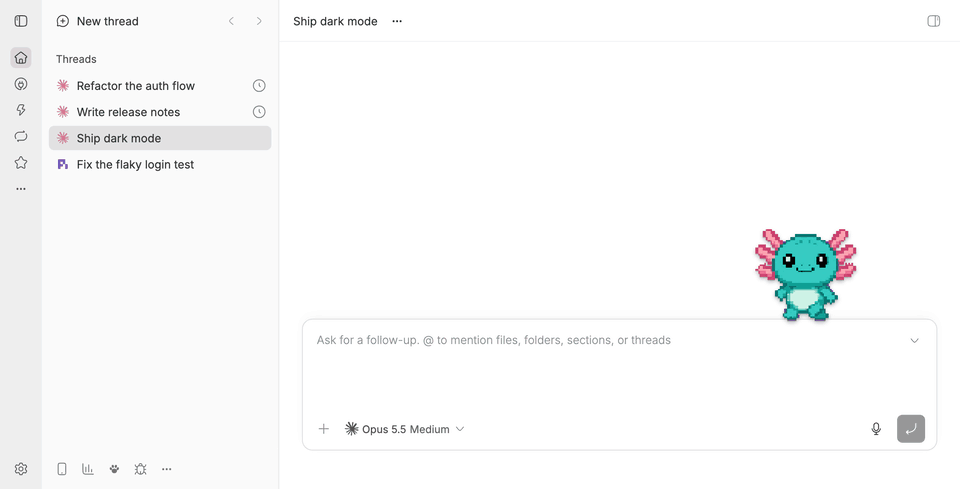
</picture>

<p align="center"><sub>A thread failed. The pet walks over, says so, and puts a ring around it in the sidebar.</sub></p>

Inspired by [Hermes pets](https://hermes-agent.nousresearch.com/docs/user-guide/features/pets), rebuilt around what bb actually is: a fleet of agents.

## Install

```sh
bb plugin install pets
```

Or straight from this repository:

```sh
bb plugin install git:https://github.com/vburojevic/bb-plugin-pets
```

> [!TIP]
> It works the moment it lands. A bundled starter pet ships with the plugin (Pixel, the axolotl in these pictures): no keys, no setup.

> [!NOTE]
> Requires bb 0.49 or later. v0.2.4 is the last release that supports older bb.

To hatch your own, add an OpenAI API key (and optionally a Retro Diffusion key) in the plugin's settings. The Hatchery spells out what each key unlocks. Keys can also be set from the CLI:

```sh
bb plugin config pets set openaiApiKey sk-…
```

## It mirrors your fleet

A pixel creature roams the bottom of your bb window and reflects what your agents are doing:

| Your fleet | The pet |
| --- | --- |
| Agents running | thinks or hustles |
| A thread blocks on you | taps its foot |
| A thread fails | droops |
| Everything quiet | sleeps |

**Pointing missions.** When a thread needs you, the pet walks to that thread's sidebar row, points at it, and pulses a highlight ring around it.

**XP and evolution.** Real work feeds it, and it only ever goes up: no hunger, no death, no nagging. Plugin-spawned and hidden threads earn nothing.

<table>
<tr>
<td width="50%" valign="top">

| Source | XP |
| --- | --- |
| Finished turn | +10 |
| Shipped thread | +15 |
| Survived failure | +2 |
| Daily hello | +20 |
| Petting | +1 |

</td>
<td width="50%" valign="top">

| Stage | From |
| --- | --- |
| Hatchling | 0 |
| Sprout | 300 |
| Adult | 1200 |
| Elder | 3500 |
| Mythic | 8000 |

</td>
</tr>
</table>

## It has a life of its own

An autonomy director sends the pet off to wander, chase the cursor, dig at the sidebar, peek from an edge, watch the composer, take zoomies or a dance break, and drop context-aware one-liners built from your real fleet numbers.

Five personality toggles (Funny, Chaotic, Sarcastic, Helpful, Cozy) and an Activity level dial (calm to unhinged) live in the Personality card. After five minutes idle it naps. Come back and it wakes, stretches, and says hello.

### The composer is terrain, not an obstacle

<picture>
  <source media="(prefers-color-scheme: dark)" srcset="docs/media/ledge-dark.gif">
  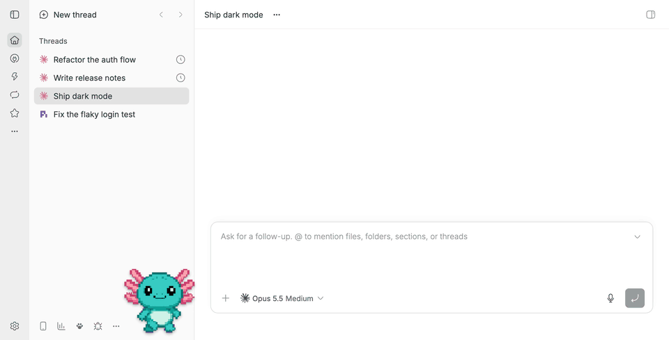
</picture>

The pet hops up onto every visible composer, split panes included, and walks along its top edge. It never loiters there, so naps, sits and digs always happen back on the floor. If it does end up over a focused input at floor level, it fades to a click-through ghost as a safety net.

### Fetch

<picture>
  <source media="(prefers-color-scheme: dark)" srcset="docs/media/fetch-dark.gif">
  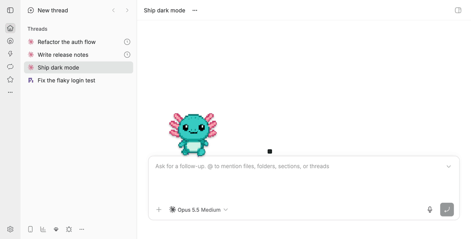
</picture>

Real physics, a run-boosted chase, and it always brings the ball back.

## Play with it

| Do this | And the pet |
| --- | --- |
| Click | gets petted |
| Drag | moves anywhere: drop high to perch, drop low to resume roaming, drop on a sidebar thread row to open that thread |
| <kbd>⌥</kbd> + scroll | resizes |
| Double-click | jumps to the neediest thread |
| Right-click | opens the full menu |
| <kbd>⌘</kbd> + click the floor | walks there |

You can also tap the Habitat ground or pick a named spot from the menu to send it somewhere.

<table>
<tr>
<td width="50%" valign="top">

<picture>
  <source media="(prefers-color-scheme: dark)" srcset="docs/media/menu-dark.png">
  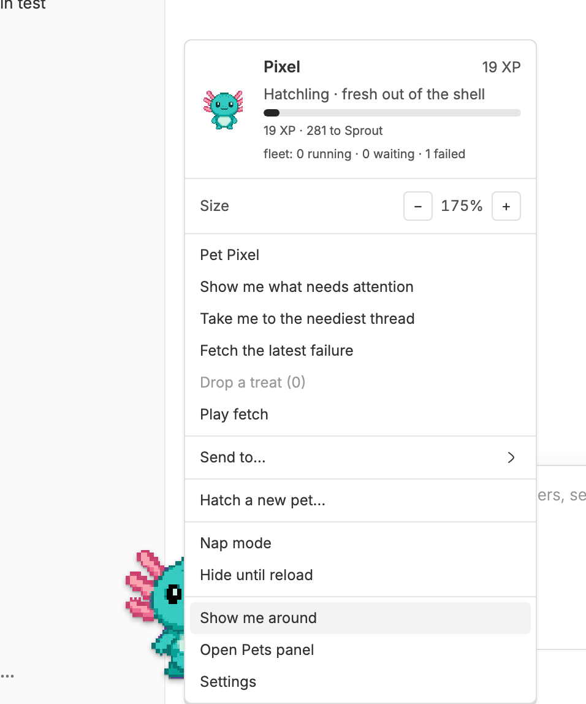
</picture>

**Right-click for the full menu:** named spots, treats, the tour, everything.

</td>
<td width="50%" valign="top">

<picture>
  <source media="(prefers-color-scheme: dark)" srcset="docs/media/tour-dark.png">
  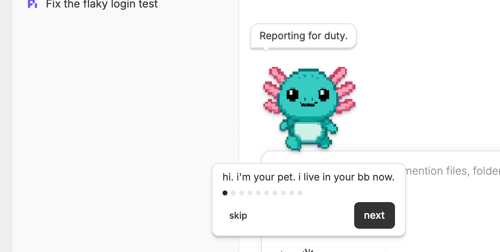
</picture>

**A tour that shows, not tells.** On first run the pet walks you through everything in 10 steps. A card follows it while it waves, demonstrates <kbd>⌘</kbd>-click walking, hops the composer ledge, and explains missions, treats, fetch, personalities and the paw button. <kbd>Esc</kbd> skips. **Show me around** in the menu, or **Take the tour** in the Habitat, runs it again.

</td>
</tr>
</table>

**Per-pet sizing.** Each pet carries its own scale, from 0.5× to 2.5×: <kbd>⌥</kbd> + scroll on the creature, or the −/+ stepper on its Den card. There is no global scale knob.

**Emotion indicator.** An optional badge above the pet names what it feels right now. It is off by default.

## The Pets panel

Four tabs in bb's navigation rail: the pet's home, its paperwork, and its birthplace.

<table>
<tr>
<td width="50%" valign="top">

<picture>
  <source media="(prefers-color-scheme: dark)" srcset="docs/media/panel-habitat-dark.png">
  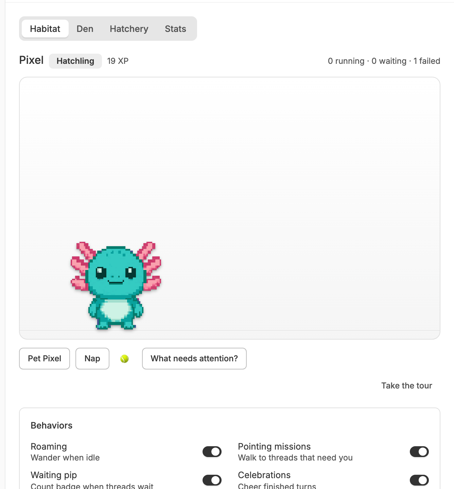
</picture>

**Habitat** is the default tab and the mobile-first home: the same canvas pet, in a container instead of the window.

</td>
<td width="50%" valign="top">

<picture>
  <source media="(prefers-color-scheme: dark)" srcset="docs/media/panel-den-dark.png">
  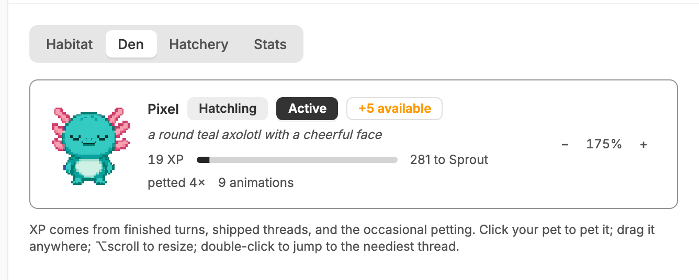
</picture>

**Den** is where you manage, rename, resize and switch pets.

</td>
</tr>
<tr>
<td width="50%" valign="top">

<picture>
  <source media="(prefers-color-scheme: dark)" srcset="docs/media/panel-hatchery-dark.png">
  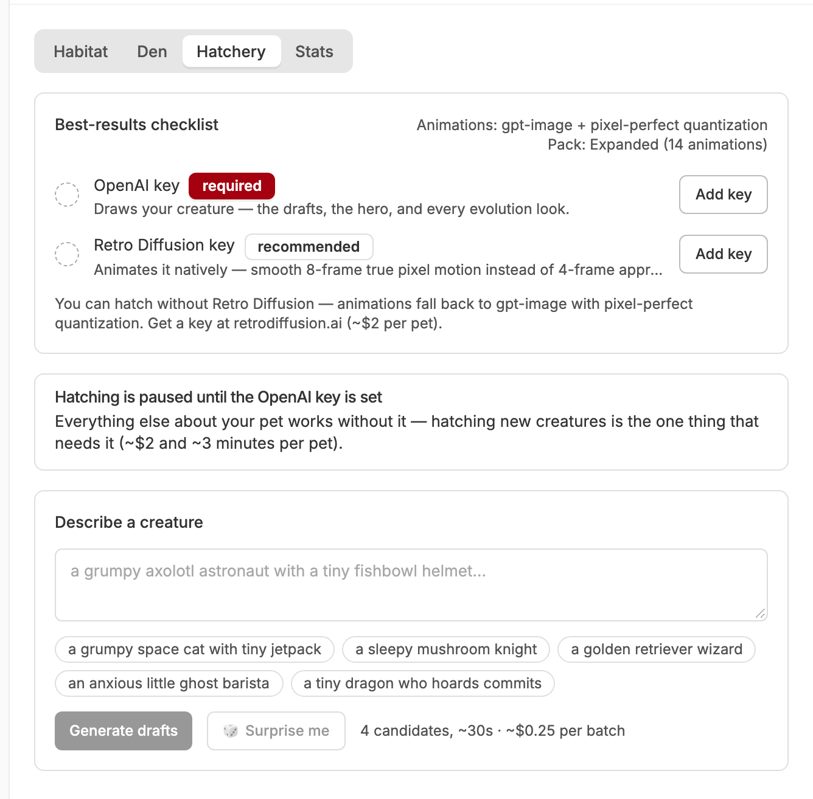
</picture>

**Hatchery** is where new pets come from.

</td>
<td width="50%" valign="top">

<picture>
  <source media="(prefers-color-scheme: dark)" srcset="docs/media/panel-stats-dark.png">
  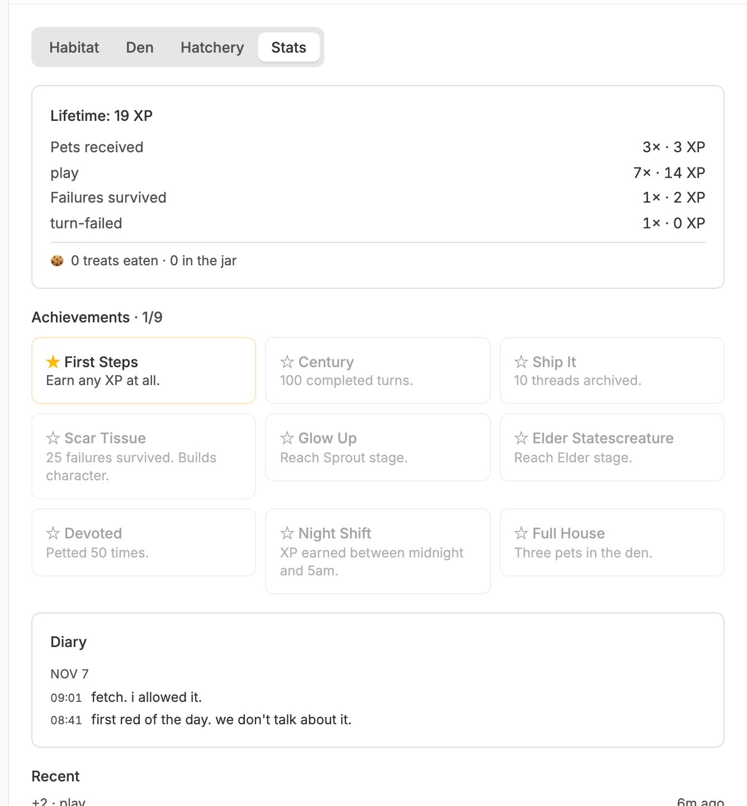
</picture>

**Stats** shows XP by source, achievements and activity.

</td>
</tr>
</table>

<table>
<tr>
<td width="50%" valign="top">

<picture>
  <source media="(prefers-color-scheme: dark)" srcset="docs/media/phone-habitat-dark.png">
  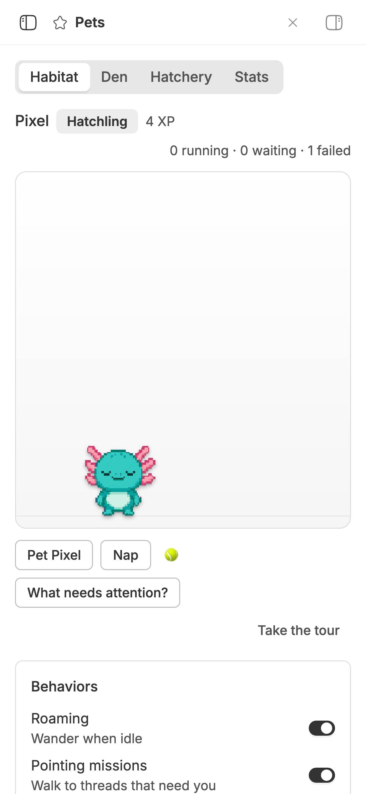
</picture>

</td>
<td width="50%" valign="top">

### On a phone

The floating pet stays off below bb's compact breakpoint, so none of its loops run on phones. The Habitat tab is where it lives there. To see the floating pet on a small screen anyway, turn off **Hide on small viewports**.

</td>
</tr>
</table>

## Hatch your own

Describe a creature, get 4 AI draft candidates, and pick one. Type a refinement like "rounder" or "make it teal" and the draft is redrawn in place. The pick becomes a fully animated pet: a gpt-image-2 hero portrait plus one animation strip per state in the configured pack.

Evolutions can regenerate the artwork per stage ("glow up"): leaf sprout, then satchel, then glasses and whiskers, then crown.

| Animation pack | States |
| --- | --- |
| `essential` | 9 |
| `expanded` (default) | 14 |
| `deluxe` | 18 |

The pack is a setting. **Re-animate** in the Den upgrades an older pet to the current pack and engine in place. **Fix animations…** on a Den card regenerates just the states you pick (walk-cycle quick-pick included) and merges them in.

> [!IMPORTANT]
> Every generation (drafts, hatch, evolve, re-animate) runs server-side in a single job slot, so it survives navigation, reloads and closed windows. The job banner at the top of the panel reattaches to whatever is running, or to whatever failed while nobody was looking.

## Reference

<details>
<summary><b>CLI</b>: <code>bb pets</code></summary>

| Command | What it does |
| --- | --- |
| `bb pets status` | Active pet, stage, XP, and fleet mood |
| `bb pets list` | All pets in the den |
| `bb pets select <name\|id>` | Make a den pet the active companion |
| `bb pets rename <name\|id> <new-name>` | Rename a pet |
| `bb pets on` | Enable the overlay |
| `bb pets off` | Disable the overlay |
| `bb pets reset` | Dev: wipe den, XP, art, drafts and reseed the starter |

</details>

<details>
<summary><b>Behavior toggles</b></summary>

Roaming, pointing missions, waiting pip, celebrations, failure reactions, dig while generating, idle quirks, typing glance, evolution ceremony, XP motes and sounds. Switch them from the Behaviors card under the Habitat. The window pet and the Habitat both honor them, along with walk speed and reduced motion.

</details>

<details>
<summary><b>Settings</b></summary>

Set these in bb under **Settings → Plugins → Pets**, or with `bb plugin config pets set <key> <value>`.

| Key | Setting | Default | What it does |
| --- | --- | --- | --- |
| `enabled` | Enabled | `true` | Master switch for the floating pet overlay. |
| `openaiApiKey` | OpenAI API key | | Used only to generate pet artwork when hatching or evolving. The bundled starter pet works without it. |
| `rdApiKey` | Retro Diffusion API key | | Optional `rdpk-…` key from retrodiffusion.ai. When set, animation strips use Retro Diffusion's native pixel-art animation model instead of gpt-image. |
| `roaming` | Roaming | `true` | Let the pet wander along the bottom of the window when nothing is happening. |
| `bubbles` | Speech bubbles | `normal` | How chatty the pet is about your fleet: `off`, `rare`, `normal`, `chatty`. |
| `reactivity` | Reactivity | `hybrid` | `hybrid`: mirror the viewed thread, fleet aggregate elsewhere. `aggregate`: always the whole fleet. `viewed-thread`: only the open thread. |
| `reducedMotion` | Reduced motion | `auto` | `auto` follows the system prefers-reduced-motion setting, or `on`. |
| `hideOnCompact` | Hide on small viewports | `true` | Keep the floating pet off below bb's compact breakpoint. |
| `pointing` | Point at threads | `true` | Walk over and point at sidebar threads that need you. |
| `walkSpeed` | Walk speed | `normal` | `chill`, `normal`, `zoomies`. |
| `sounds` | Sounds | `false` | Tiny synth chirps for greetings, evolutions, and pets. |
| `soundVolume` | Sound volume | `normal` | `quiet` or `normal`. |
| `xpMotes` | XP motes | `true` | Show floating +XP numbers above the pet. |
| `reactTurnComplete` | Celebrate finished turns | `true` | Brief celebration when an agent finishes a turn. |
| `reactFailures` | React to failures | `true` | Startled or sad reactions and a grumpy mood when threads fail. |
| `digWhileGenerating` | Dig during generation | `true` | The pet digs while artwork generates. |
| `idleQuirks` | Idle quirks | `true` | Occasional waves and look-arounds when idle. |
| `typingGlance` | Typing glance | `true` | Glances up when you start typing a prompt. |
| `evolutionCeremony` | Evolution ceremony | `true` | Dance, sparkles and fanfare on stage-up. Off means quiet level-ups. |
| `attentionPip` | Waiting pip | `true` | The bouncing count badge when threads wait on you. |
| `showEmotions` | Emotion indicator | `false` | A small badge above the pet naming what it feels right now. |
| `personalityFunny` | Personality: funny | `true` | Observational one-liners and the occasional dance break. |
| `personalityChaotic` | Personality: chaotic | `true` | Zoomies, cursor chasing, edge peek-a-boo, digging at the sidebar. |
| `personalitySarcastic` | Personality: sarcastic | `true` | Dry commentary on failures, marathon turns, and your thread hoard. |
| `personalityHelpful` | Personality: helpful | `true` | Nudges about waiting threads and a bb tip now and then. |
| `personalityCozy` | Personality: cozy | `true` | Wandering, sitting nearby, naps when you go idle, welcome-backs. |
| `activityLevel` | Activity level | `lively` | How often the pet does things on its own: `calm`, `normal`, `lively`, `unhinged`. |
| `highContrast` | High-contrast accents | `false` | Thicker, brighter highlight ring and a stronger emotion badge. |
| `seasonalFlair` | Seasonal flair | `true` | A small seasonal accessory on the pet in festive months. |
| `devMode` | Developer panel | `false` | Live state feed and event log on the Stats tab. For debugging. |
| `imageModel` | Image model | `gpt-image-2` | OpenAI Images API model for heroes and drafts. |
| `spriteEngine` | Sprite engine | `auto` | `auto` uses Retro Diffusion for animations when its key is set; or `openai`, `retro-diffusion`. |
| `animationPack` | Animation pack | `expanded` | `essential` (9 animations, about $2 per pet), `expanded` (14, about $3.20), `deluxe` (18, about $4.30). |
| `pixelPerfect` | Pixel-perfect quantization | `true` | Snap gpt-image output to a true pixel grid with a shared palette. |

</details>

<details>
<summary><b>Architecture notes</b></summary>

- The overlay is an **app-wide overlay slot** (`app.slots.experimental_appOverlay`), so it reads through the same SDK hooks as every other surface: `useRpc` for calls, `useRealtime` for the `pets` channel, `useBbContext` for the thread in view, and `useBbNavigate` to open threads and panels. Below bb's compact breakpoint it renders nothing unless **Hide on small viewports** is off, so by default none of its loops run on phones.
- Sprites render on a **canvas** (integer source rects, smoothing off). CSS background-position sprites bleed adjacent frames at fractional sizes.
- **Fleet state lives server-side** (lifecycle events plus `thread:changed` interaction metadata, seeded from `threads.list`), so XP accrues and the CLI works with zero windows open.
- **Generation** (`src/spritegen.ts`): heroes and drafts come from **gpt-image-2** with an automatic magenta chroma-key fallback (the model drops native transparency often enough that keying is the reliable path). Animation strips come from **Retro Diffusion**'s pixel-native animation API when an `rdpk-` key is set: 16-frame walk and idle loops, 8 frames elsewhere, native 64 px. Otherwise they come from gpt-image strips (one row of four; models miscount larger grids) with flood-deglow.
- How many strips get generated is the **animation pack** (`ANIMATION_PACKS` in `src/atlas.ts`: essential 9, expanded 14, deluxe 18). Missing states fall back through `STATE_FALLBACKS`, so a pet on a smaller pack still plays everything.
- Everything gpt-made passes through `src/quantize.ts`: baseline alignment, nearest downscale to 64 px cells, and a shared 24-color median-cut palette. True pixel art from any model.
- **Side-profile locomotion.** Retro Diffusion animates the hero exactly as posed, so a front-facing portrait produced a front-facing walk. Each pet caches a right-facing side-profile hero variant (one gpt-image edit, refreshed on evolution) that feeds the walk and run strips only. Everything else still animates from the straight-on hero.

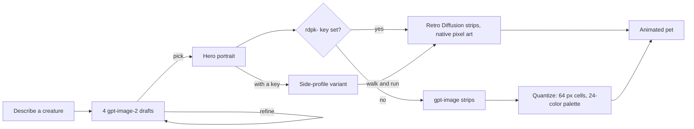

</details>

<details>
<summary><b>Development</b></summary>

```sh
npm install
bb plugin dev        # watch: rebuild the app bundle and reload on save
npx tsc --noEmit     # typecheck
npm test             # unit tests
```

</details>

## More bb plugins

See every bb plugin I publish at [**vburojevic/bb-plugins**](https://github.com/vburojevic/bb-plugins).
